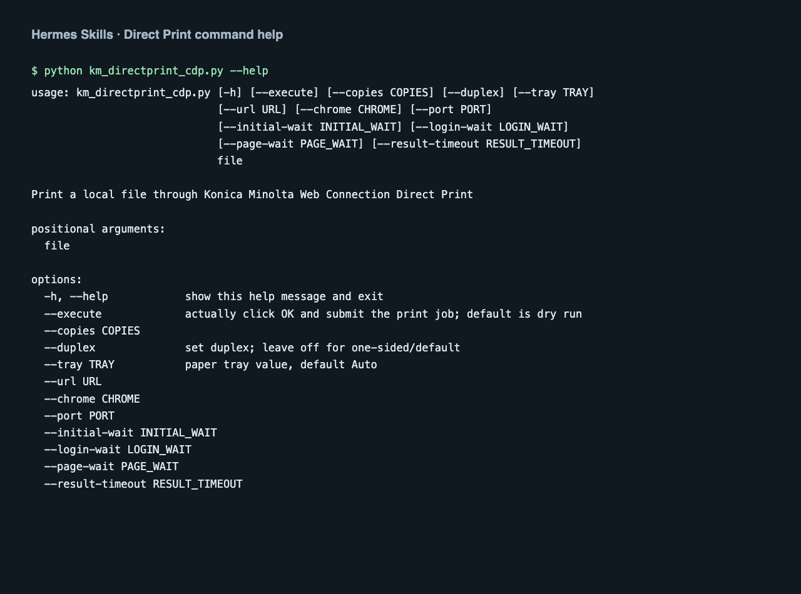

# hermes-skills

## Preview and download



Actual `--help` output from the included Direct Print script, displayed as a readable command-output screenshot. This repository contains skills and scripts rather than a graphical application. Download the **installable skill folders** in the [release ZIP](https://github.com/2fast4youu/hermes-skills/releases/tag/downloads-2026-10-22), then copy the desired folder into `~/.hermes/skills/`.

Practical skills for [Hermes Agent](https://github.com/NousResearch/hermes-agent), each one extracted from a setup that runs every day.
Every skill is a plain `SKILL.md` (plus scripts where useful), so it also works with other agents that read Markdown skill files (Claude Code, Codex, …).

| Skill | What it does |
|---|---|
| [`bambu-printer-mqtt`](bambu-printer-mqtt/SKILL.md) | Control Bambu Lab 3D printers (A1/P1/X1) via cloud or local MQTT. Includes the fix for the new firmware command-signature lock. |
| [`konica-webconnection-directprint`](konica-webconnection-directprint/SKILL.md) | Print files on Konica Minolta bizhub printers through their Web Connection UI with headless Chromium. No driver, no CUPS. |
| [`saml-shibboleth-requests-login`](saml-shibboleth-requests-login/SKILL.md) | Log in to Shibboleth/SAML-protected sites (e.g. university portals) with plain `requests`, without a browser. |
| [`wacli-whatsapp-cli-ops`](wacli-whatsapp-cli-ops/SKILL.md) | Operate the [wacli](https://github.com/openclaw/wacli) WhatsApp CLI: query the local store, re-auth via phone pairing, draft messages in the user's own voice. |

## Install

```bash
git clone https://github.com/2fast4youu/hermes-skills.git
cp -r hermes-skills/<skill-name> ~/.hermes/skills/
```

Hermes picks up new skills in the next session.

## Notes

- No credentials are stored here. Skills that need them (printer IP, access codes, tokens) read them from env vars or a local config file you create yourself.
- Skills with real-world side effects (printing, sending messages, printer control) default to a dry run or require explicit confirmation.

## License

MIT
